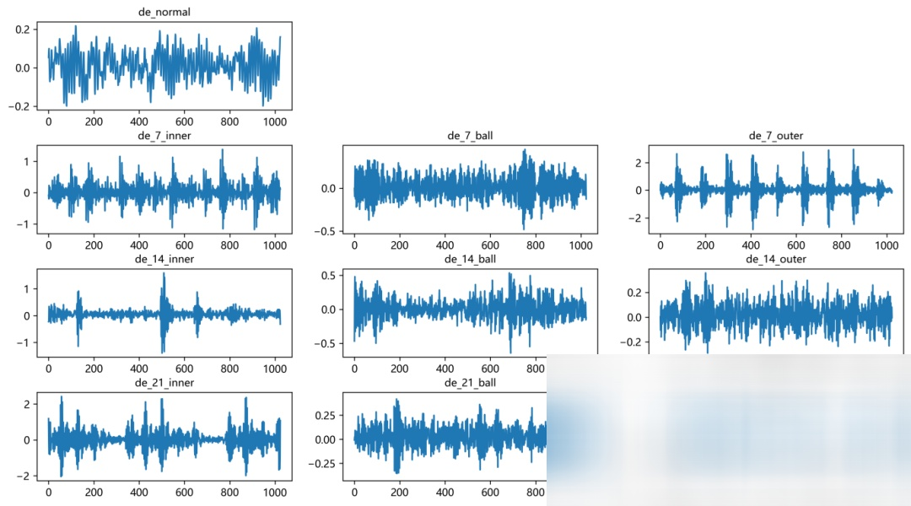

# Bearing Fault Diagnosis EMD-CNN-Transformer Fault Classification Model

Including the complete CWRU bearing fault dataset, as well as the fault signal dataset, classification data, and label set that have been generated and ready for use.
Fault Diagnosis Model Update: A Comprehensive Tutorial on EMD Decomposition + CNN-Transformer Classification Model!
Preface
This issue primarily updates the tutorial on the Caterpillar Western Reserve University (CWRU) bearing data + EMD-CNN-Transformer classification model based on Python.
We have added detailed tutorials for datasets and preprocessing, Jupyter code tutorials, and PyCharm code tutorials. We have also implemented the code in a more standardized manner using the PyCharm editor and optimized the training process code. Additionally, we have supplemented video tutorials on CNN-Transformer models and parameters to facilitate beginners' learning! Please update and follow the video tutorials for running!
● Dataset: Case Western Reserve University (CWRU) Bearing Dataset
1. Update Introduction
1.1 New video tutorials:
\tA detailed video tutorial has been added, providing a deep and easy-to-understand explanation suitable for beginners in the series of fault diagnosis models. Additionally, an introduction to the parameters of the CNN-Transformer parallel model has been included!
1.2 Jupyter Code Updates:
(1) Increased Visualization of Data Sets
(2) Optimize training code
The optimized training code has significantly reduced the training time!
1.3 PyCharm Code Update:
We strictly follow the complete GitHub-Pytorch deep learning project structure, rewriting the code to facilitate learning and cultivate standard coding habits! If you need to write open source code for future papers, you can also reconstruct the code following this template!
2. Bearing Data Loading and Preprocessing
2.1 Import Data
Referencing previous articles, preprocessing for fault classification in 10 categories is carried out. The Case Western Reserve University bearing data 10-category dataset:
train_set, val_set, test_set are divided into training set, validation set, and test set at a ratio of 7:2:1, and finally saved the data.
2.2 Fault EMD Decomposition Visualization
2.3 Fault Data EMD Decomposition Preprocessing
From the results, it can be seen that most signal samples have decomposed into 8 components, nearly one-third of the signals did not decompose into 8 components. The EMD settings cannot determine the number of mode components (function adaptive), in order to achieve the same dimensionality of component features for one-dimensional signal decomposition, there are three processing methods:
- Delete samples with unequal decomposition components (a small number of cases can adopt);
- For samples with few components, use zero values or other methods to fill in the feature to align with the dimensions of other sample components (toward multi-compatibility);
- Merge signals with many components (toward less compatibility);
Our model adopts a combination of the second and third methods for preprocessing, i.e., delete samples with fewer components, and for those with more components, merge excess components to keep all signal component features consistent in dimensionality.
3. Diagnosis Model Based on EMD+CNN-Transformer
3.1 Define EMD+CNN-Transformer Network Model
3.2 Set parameters and train the model
\t50 epochs, accuracy 100%, EMD+CNN-Transformer \tsignificant network classification effects. \tThe model can fully extract multi-scale features of bearing fault signals, with fast convergence and exceptional performance, resulting in noticeable improvements.
\t3.3 Model Evaluation
\t(1) Accuracy, Precision, Recall, F1 Score
\t(2) Fault Classification Confusion Matrix:
4 Download update address
\t
\t34 classic bearing fault diagnosis models collection | the most cost-effective download link on the internet:
\tpreviously interesting content:
END
\t2. Friends who like this can click to follow, give the article a "like", share it on WeChat Moments or discuss groups.

## Images

<!-- PAYMENT_BLOCK -->

## Get this dataset

- Payment link (Stripe): [Buy now](https://buy.stripe.com/3cs8yP7sY87d0vu9AB)
- Payment QR code: 

<!-- /PAYMENT_BLOCK -->
